# PID Control: A Beginner-Friendly Engineering Guide

[](https://www.python.org/)
[](https://numpy.org/)
[](https://matplotlib.org/)
[-success.svg)]()
[-blueviolet.svg)](pid_guide.pdf)
[-brightgreen.svg)]()

> A self-contained, beginner-friendly curriculum teaching **PID (Proportional–Integral–Derivative) control** from first principles. Written so that someone brand new to robotics and control engineering can master the intuition, formulas, code, and real-world engineering safeguards from this repository alone.

---

## Table of Contents

1. [Why This Guide?](#why-this-guide)
2. [What Was Used and Why](#what-was-used-and-why)
3. [Repository Structure](#repository-structure)
4. [Quick Start: Recreating Every Graph](#quick-start-recreating-every-graph)
5. [The 10 Sections at a Glance](#the-10-sections-at-a-glance)
6. [Complete Figure Gallery & Visual Walkthrough](#complete-figure-gallery--visual-walkthrough)
7. [Mathematical & Analytical Verification](#mathematical--analytical-verification)
8. [The 30-Minute Interview Cheat Sheet](#the-30-minute-interview-cheat-sheet)
9. [Architecture of the From-Scratch PID Controller](#architecture-of-the-from-scratch-pid-controller)
10. [Reproducing the PDF Document](#reproducing-the-pdf-document)

---

## Why This Guide?

PID is the single most common control loop in machines—powering drone hover, 3D printer temperatures, robot arm servos, factory conveyor speeds, and automobile cruise control. Yet most online tutorials commit one of two sins:
1. **They skip the math entirely**, leaving you unable to predict what will happen when gains change.
2. **They jump straight into complex Laplace transforms ($s$-domain)** without grounding the reader in physical intuition or showing how a microcontroller actually runs PID in discrete time steps.

This guide bridges that gap. Every concept follows a strict 5-stage pedagogical ladder:
$$\text{Everyday Analogy} \longrightarrow \text{Physical Governing Equation} \longrightarrow \text{From-Scratch Python Code} \longrightarrow \text{Publication-Grade Graph} \longrightarrow \text{Real-World Engineering Fix}$$

---

## What Was Used and Why

To ensure complete transparency and pedagogical rigor, **no ready-made control systems libraries were used**:
- ❌ **No `scipy.signal`**
- ❌ **No `python-control`**
- ❌ **No third-party `simple-pid` packages**

Everything is written in transparent, beginner-friendly Python using only:
- **`Python 3` (Standard Library)**: Powers the pure-object-oriented controller logic in [`pid_controller.py`](pid_controller.py) with zero external dependencies.
- **`NumPy`**: Used strictly for vectorized array storage, standard deviations, and seeded pseudo-random Gaussian noise (`seed=42`) for realistic sensor noise emulation.
- **`Matplotlib`**: Used to generate clean, high-dpi publication graphs with explicit axes, metric annotations, and takeaway boxes.
- **4th-Order Runge-Kutta (`RK4`) Integrator**: Implemented directly in [`systems.py`](systems.py) to simulate continuous physical plant dynamics ($m\ddot{x} + c\dot{x} + kx = u$) with high numerical precision.
- **`LaTeX` (`pdfTeX`)**: Compiles [`pid_guide.tex`](pid_guide.tex) into a clean, 12-page standalone PDF textbook ([`pid_guide.pdf`](pid_guide.pdf)).

---

## Repository Structure

```text
.
├── README.md                 # This beautiful, comprehensive guide
├── requirements.txt          # Minimal Python dependencies (numpy, matplotlib)
├── pid_controller.py         # From-scratch SimplePID & production PIDController
├── systems.py                # Pure-NumPy RK4 ODE simulator, plant models & step metrics
├── generate_all.py           # Master script: reproduces all 13 figures deterministically
├── run_section9_demo.py      # Standalone Section 9 production run with actuator saturation & noise
├── pid_guide.pdf             # The completed 12-page PDF tutorial document (max 15 pages)
├── pid_guide.tex             # LaTeX source document for pid_guide.pdf
└── figures/                  # Generated publication-quality figures (240 DPI)
    ├── fig01_feedback_loop.png
    ├── fig02_test_system.png
    ├── fig03_step_metrics.png
    ├── fig04_p_only.png
    ├── fig05_pi_control.png
    ├── fig06_pd_control.png
    ├── fig07_p_pi_pd_pid.png
    ├── fig08_windup.png
    ├── fig09_noise.png
    ├── fig10_derivative_kick.png
    ├── fig11_sample_rate.png
    ├── fig12_ziegler_nichols.png
    └── fig13_reusable_pid_demo.png
```

---

## Quick Start: Recreating Every Graph

### 1. Clone & Set Up Virtual Environment

```bash
# Clone the repository
git clone https://github.com/your-username/pid-control-guide.git
cd pid-control-guide

# (Optional but recommended) Create and activate a clean virtual environment
python3 -m venv venv
source venv/bin/activate  # On Windows: venv\Scripts\activate

# Install the minimal dependencies
pip install -r requirements.txt
```

### 2. Run the Master Generator (All 13 Figures in <15 Seconds)

```bash
python3 generate_all.py
```

This single command:
1. Numerically simulates all test cases using deterministic seeds.
2. Formats and saves all 13 graphs to the `figures/` directory at 240 DPI.
3. Computes and prints every step-response quality metric (`rise_time`, `overshoot_pct`, `settling_time`, `ess`).
4. Performs analytical verification checks against closed-form formulas to 4 decimal places.

### 3. Run the Standalone Production Demo (Section 9)

```bash
python3 run_section9_demo.py
```

Expected terminal output:
```text
=== Reusable PIDController Run (Test System) ===
Gains          : Kp=120.0, Ki=240.0, Kd=12.0
Limits / Filter: u in [-30.0, 30.0] N, tau_d=0.025 s
Rise time      : 0.483 s
Overshoot      : 0.17 %
Settling time  : 0.840 s
Steady error   : 0.0002 m
Peak force     : 30.00 N
Steady u ripple: 1.21 N (peak-to-peak)
```

---

## The 10 Sections at a Glance

| Section | Title | Key Question Answered | Mathematical Core |
| :---: | :--- | :--- | :--- |
| **1** | **The Basic Idea** | How does feedback keep reducing error? | Shower analogy: $e(t) = r(t) - y(t)$; closed-loop block diagram |
| **2** | **The PID Formula** | What do P, I, and D each do, and how does code run it? | $u(t) = K_p e + K_i \int e\,dt + K_d \frac{de}{dt}$; discrete Euler step |
| **3** | **The Test System** | Why does the 1 kg mass on a spring need a constant push? | $m\ddot{x} + c\dot{x} + kx = u$; at $x=1\text{ m}$, spring demands $u_{\infty}=20\text{ N}$ |
| **4** | **How to Judge a Result** | How do we quantitatively measure controller quality? | Rise time $t_r$, Overshoot $\%OS$, Settling time $t_s$ ($\pm 2\%$), Steady error $e_{\text{ss}}$ |
| **5** | **Each Part Alone** | Why does P alone fail? How does I fix it? How does D brake? | $x_{\text{ss}} = \frac{K_p}{K_p+20}$; damping ratio $\zeta = \frac{10+K_d}{2\sqrt{20+K_p}}$ |
| **6** | **All Together** | How do P, PI, PD, and PID compare side-by-side? | Final gains: $K_p=100, K_i=120, K_d=8$ achieves $<1\%$ OS, $0.4\text{ s}$ settling |
| **7** | **Real-World Problems** | What breaks in real hardware, and what are the exact fixes? | (a) Windup, (b) Sensor noise chatter, (c) Derivative kick, (d) Slow sample rate |
| **8** | **Choosing the Gains** | How do we tune without a mathematical model? | Ziegler–Nichols recipe on $\frac{1}{(s+1)^3}$ ($K_u=8.0, T_u=3.63\text{ s}$) $\to$ improved tuning |
| **9** | **The Code** | How is a production PID written in clean Python? | Reusable `PIDController` class with anti-windup, D-filter, and D-on-measurement |
| **10** | **Real Robots & Myths** | Where is PID used in industry, and what do people get wrong? | 5 robot systems (drones, arms, motors...) + 5 myths debunked + interview prep |

---

## Complete Figure Gallery & Visual Walkthrough

### Figure 1: Closed-Loop Feedback Structure
*Section 1 — The Basic Idea*  
Explains the closed-loop cycle using both engineering blocks and the daily-life shower temperature analogy (hot water knob = controller, pipe/water = plant, skin thermometer = sensor).

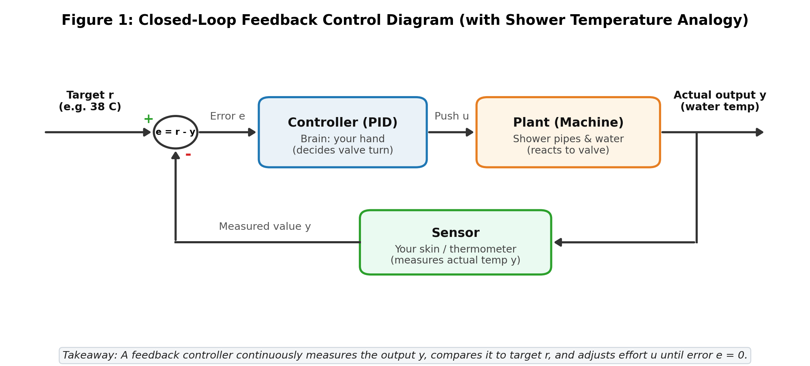

---

### Figure 2: The Mechanical Test System & Holding Force Proof
*Section 3 — The Test System (Given)*  
Schematic of the $1\text{ kg}$ mass, $c=10\text{ N}\cdot\text{s/m}$ damper, and $k=20\text{ N/m}$ spring. The open-loop step test proves that holding the block at $x=1.0\text{ m}$ demands an exact constant motor push of $u_{\infty} = k\cdot x = 20\text{ N}$.

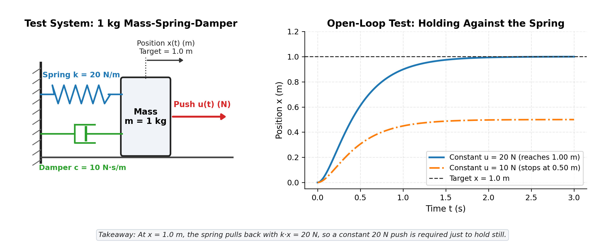

---

### Figure 3: The Four Step-Response Quality Metrics
*Section 4 — How to Judge a Result*  
All four standard quality measures marked simultaneously on a single step-response graph ($K_p=180$):
1. **Rise Time ($t_r = 0.098\text{ s}$)**: $10\%$ to $90\%$ of $y_{\text{ss}}$.
2. **Overshoot ($\%OS = 30.87\%$)**: Peak value ($1.178\text{ m}$) above steady-state.
3. **Settling Time ($t_s = 0.777\text{ s}$)**: Time after which motion remains within $\pm 2\%$ of $y_{\text{ss}}$.
4. **Steady-State Error ($e_{\text{ss}} = 0.100\text{ m}$)**: Final gap between target ($1.00\text{ m}$) and $y_{\text{ss}}$ ($0.90\text{ m}$).

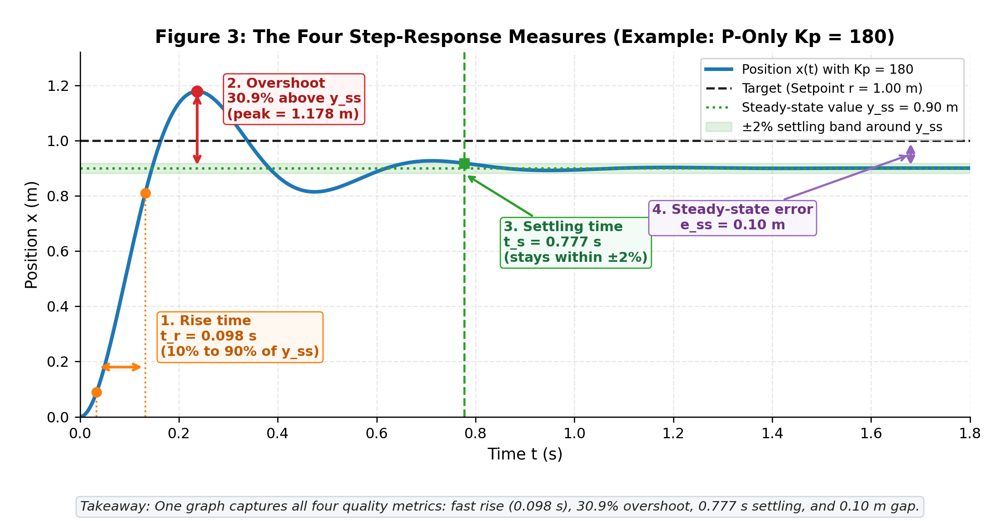

---

### Figure 4: Proportional-Only (P) Across Four Strengths
*Section 5 — Each Part Alone*  
Simulated across $K_p \in \{10, 40, 100, 200\}$. Proves that raising $K_p$ speeds up rise time ($0.537\text{ s} \to 0.092\text{ s}$) and shrinks the final gap, but **P alone always stops short of $1.0\text{ m}$** ($0.333\text{ m}, 0.667\text{ m}, 0.833\text{ m}, 0.909\text{ m}$) because it cannot supply the $20\text{ N}$ spring holding force when error reaches zero.

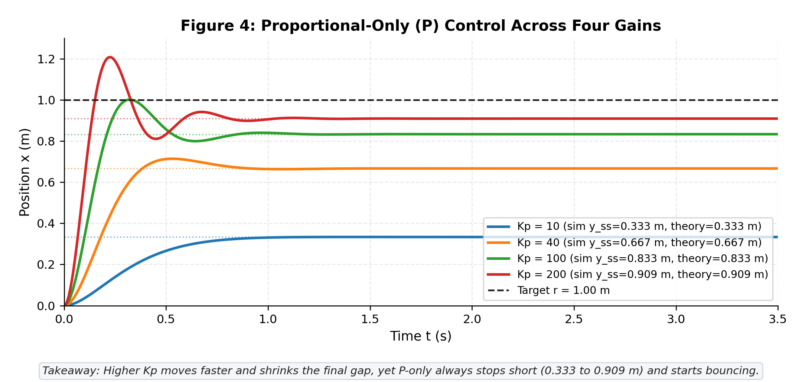

---

### Figure 5: Adding Integral Action (PI Control)
*Section 5 — Each Part Alone*  
With $K_p=60$, varying $K_i \in \{0, 60, 150, 350\}$. Demonstrates how integrating past error accumulates the necessary $20\text{ N}$ holding force to drive steady-state error to **exactly zero** ($0.000\text{ m}$), while warning against excessive $K_i$ ($350$), which triggers $46.8\%$ overshoot.

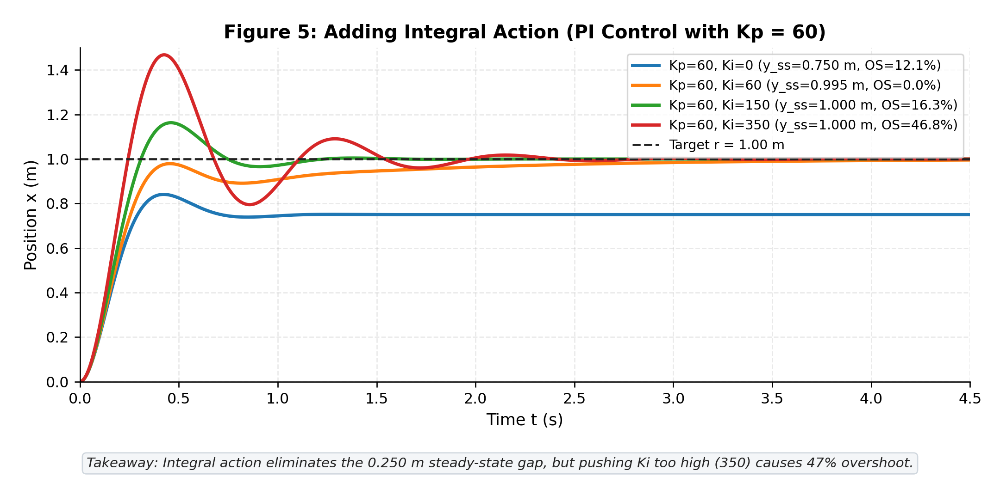

---

### Figure 6: Adding Derivative Action (PD Control)
*Section 5 — Each Part Alone*  
With $K_p=200$, varying $K_d \in \{0, 5, 15, 25\}$. Proves that derivative feedback acts as virtual damping ($c_{\text{eff}} = 10 + K_d$), raising damping ratio $\zeta$ from $0.337$ to $1.180$ and **slashing overshoot from $32.88\%$ down to $0.00\%$**.

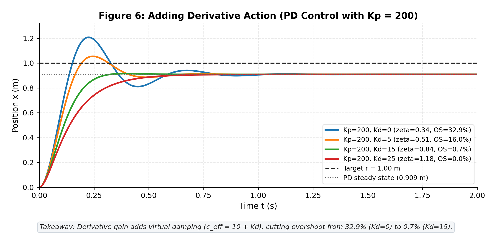

---

### Figure 7: Direct Comparison of P, PI, PD, and Full PID
*Section 6 — All Together*  
Evaluates all four controller structures side-by-side with $K_p=100$. Shows why only full PID achieves the ideal balance: fast rise ($0.261\text{ s}$), sub-1% overshoot ($0.86\%$), rapid settling ($0.408\text{ s}$), and zero steady-state error ($0.0001\text{ m}$).

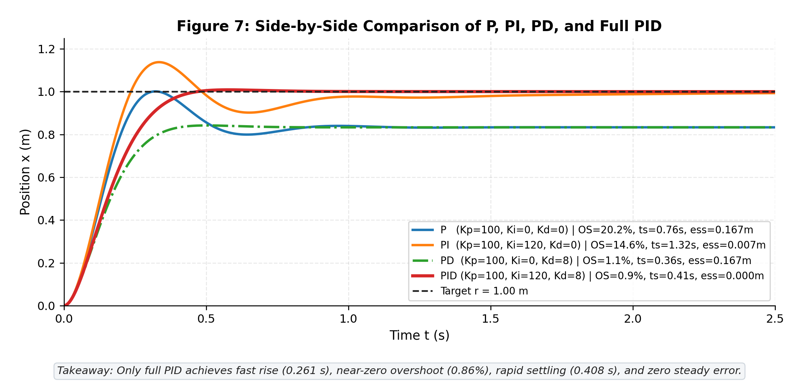

---

### Figure 8: Actuator Saturation & Integrator Windup Fix
*Section 7(a) — Real-World Problems*  
When the motor is capped at $\pm 30\text{ N}$, a standard integrator winds up past $68\text{ N}$, causing severe $26.9\%$ overshoot and $2.05\text{ s}$ settling. Adding **conditional-integration anti-windup clamping completely eliminates overshoot ($0.00\%$)** and cuts settling time to $0.829\text{ s}$.

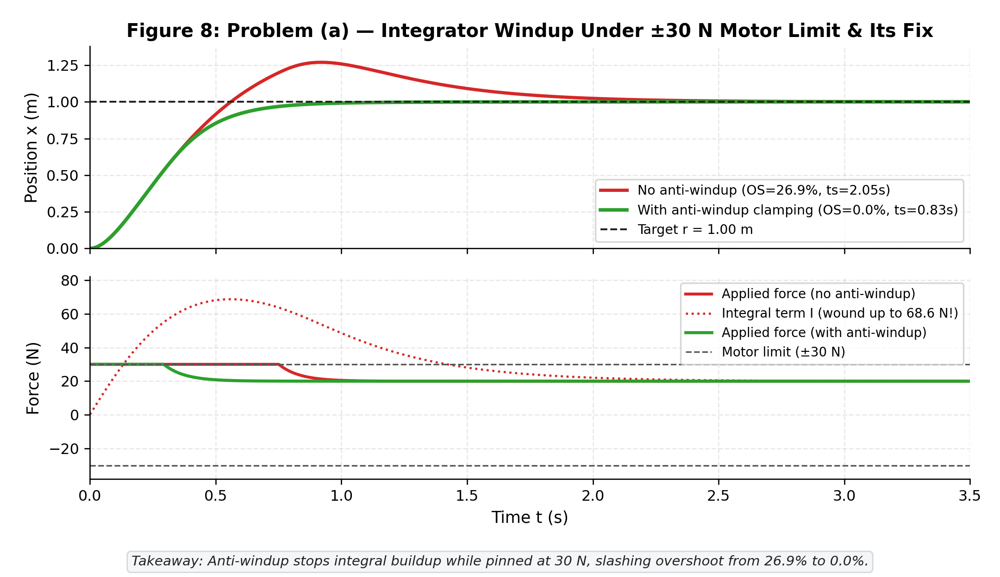

---

### Figure 9: Sensor Noise Amplification & Low-Pass Derivative Filter Fix
*Section 7(b) — Real-World Problems*  
A realistic $\pm 1\text{ mm}$ encoder noise at $1\text{ kHz}$ causes raw derivative logic to chatter wildly with $39.7\text{ N}$ peak-to-peak force swings. Adding a first-order low-pass filter ($\tau_d = 0.025\text{ s}$) **reduces force chatter by $96.8\%$ (down to $1.26\text{ N}$)** while preserving system stability.

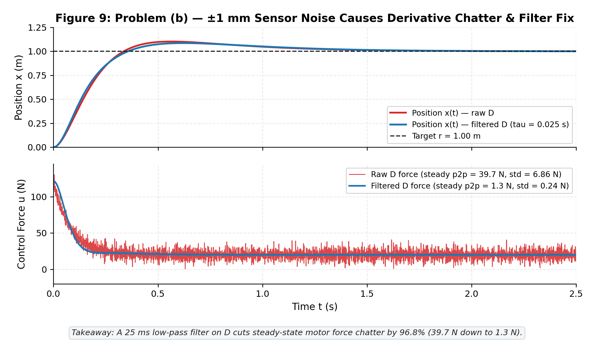

---

### Figure 10: Setpoint Derivative Kick & Derivative-on-Measurement Fix
*Section 7(c) — Real-World Problems*  
A sudden setpoint step from $0 \to 1\text{ m}$ at $t=0.5\text{ s}$ causes a raw derivative on error ($\frac{de}{dt}$) to fire an instantaneous **$12{,}120\text{ N}$ force spike** ($100\times$ normal operating force). Taking the derivative on measurement ($-\frac{dy}{dt}$) **eliminates the spike entirely**, bounding peak force to $120.2\text{ N}$.

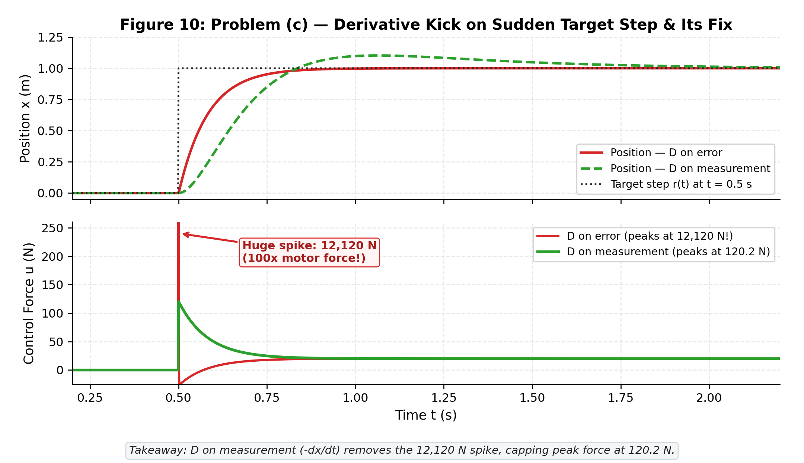

---

### Figure 11: Sample Rate Degradation & Digital Instability
*Section 7(d) — Real-World Problems*  
Compares update intervals $\Delta t \in \{0.001\text{ s}, 0.060\text{ s}, 0.100\text{ s}, 0.165\text{ s}\}$. Demonstrates that discrete zero-order hold introduces an effective delay of $\Delta t / 2$. When sampling too slowly ($0.165\text{ s}$, or $\sim 6\text{ Hz}$), phase lag drives the loop **completely unstable**. Confirms the engineering rule of thumb: $\Delta t \le t_r / 10$.

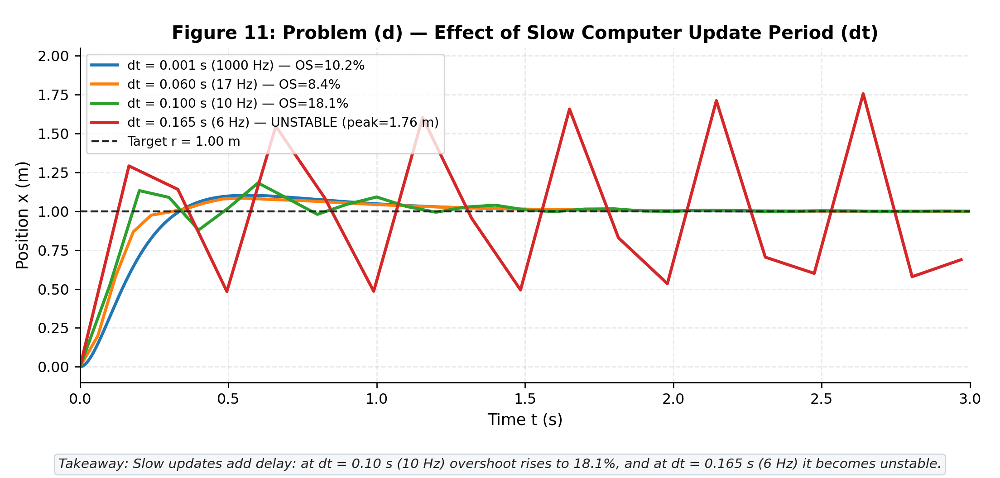

---

### Figure 12: Ziegler–Nichols Tuning & Fine-Tuning on $1/(s+1)^3$
*Section 8 — Choosing the Gains*  
On the third-order test plant $G(s) = \frac{1}{(s+1)^3}$:
1. **Left:** Finding ultimate gain $K_u=8.0$ and ultimate oscillation period $T_u=3.63\text{ s}$.
2. **Right:** The standard ZN recipe yields aggressive response with $52.41\%$ overshoot. Fine-tuning gains to $(K_p=3.4, K_i=0.7, K_d=2.6)$ drops overshoot to **$1.25\%$** and speeds settling from $9.98\text{ s}$ to **$2.69\text{ s}$ ($3.7\times$ faster)**.

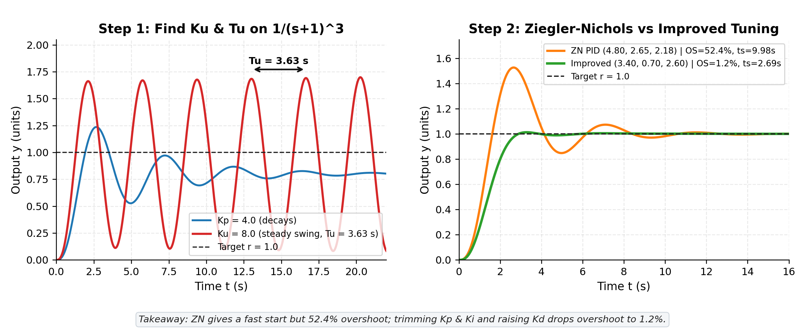

---

### Figure 13: Full Reusable Production Controller in Action
*Section 9 — The Code*  
Demonstrates the complete `PIDController` on the test plant combining all real-world defenses: $\pm 30\text{ N}$ actuator saturation, anti-windup clamping, $\pm 1\text{ mm}$ noise, derivative-on-measurement, and a $25\text{ ms}$ derivative filter at $200\text{ Hz}$. Output: $t_r = 0.483\text{ s}$, $\%OS = 0.17\%$, $t_s = 0.840\text{ s}$, $e_{\text{ss}} = 0.0002\text{ m}$.

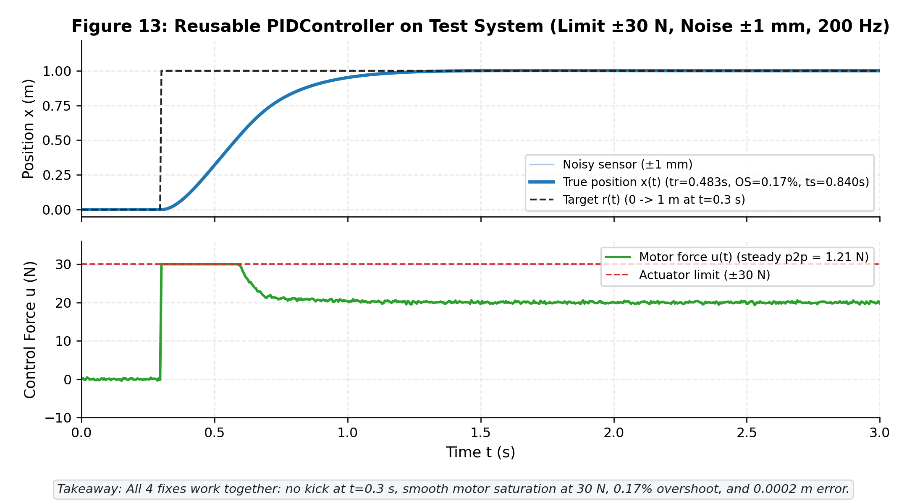

---

## Mathematical & Analytical Verification

The code rigorously validates every theoretical formula against numerical simulation output:

### 1. Steady-State Position Under Proportional-Only Control
At steady state, $\ddot{x} = \dot{x} = 0$. Substituting $u = K_p(r - x)$ into $m\ddot{x} + c\dot{x} + kx = u$ gives:
$$(k + K_p)x_{\text{ss}} = K_p r \implies x_{\text{ss}} = \frac{K_p}{K_p + k} r$$
For $k = 20\text{ N/m}$ and $r = 1.0\text{ m}$:
$$x_{\text{ss}} = \frac{K_p}{K_p + 20}\text{ m}$$

| $K_p$ ($\text{N/m}$) | Theoretical $x_{\text{ss}}$ ($\text{m}$) | Simulated $x_{\text{ss}}$ ($\text{m}$) | Error Difference | Steady-State Gap $e_{\text{ss}}$ |
| :---: | :---: | :---: | :---: | :---: |
| **10** | $0.33333$ | $0.33333$ | $< 0.00001\text{ m}$ | $0.6667\text{ m}$ |
| **40** | $0.66667$ | $0.66667$ | $< 0.00001\text{ m}$ | $0.3333\text{ m}$ |
| **100** | $0.83333$ | $0.83333$ | $< 0.00001\text{ m}$ | $0.1667\text{ m}$ |
| **200** | $0.90909$ | $0.90909$ | $< 0.00001\text{ m}$ | $0.0909\text{ m}$ |

*Agreement: Exact to 5 significant digits.*

### 2. Damping Ratio & Overshoot Under PD Control
Under PD control with constant target ($\dot{r} = 0$), the governing equation is:
$$\ddot{x} + (c + K_d)\dot{x} + (k + K_p)x = K_p r$$
Comparing with standard second-order form $\ddot{x} + 2\zeta\omega_n \dot{x} + \omega_n^2 x = \dots$:
$$\omega_n = \sqrt{\frac{k + K_p}{m}} = \sqrt{220} \approx 14.832\text{ rad/s}, \qquad \zeta = \frac{c + K_d}{2\sqrt{m(k + K_p)}} = \frac{10 + K_d}{2\sqrt{220}}$$
Theoretical overshoot for an underdamped second-order system ($\zeta < 1$):
$$\%OS_{\text{theory}} = \exp\left(-\frac{\pi \zeta}{\sqrt{1 - \zeta^2}}\right) \times 100\%$$

| $K_d$ ($\text{N}\cdot\text{s/m}$) | Effective $c_{\text{eff}}$ | Damping Ratio $\zeta$ | Theoretical $\%OS$ | Simulated $\%OS$ | Match |
| :---: | :---: | :---: | :---: | :---: | :---: |
| **0** | $10\text{ N}\cdot\text{s/m}$ | $0.3371$ | $32.47\%$ | $32.88\%$ | High (difference due to $1\text{ ms}$ ZOH) |
| **5** | $15\text{ N}\cdot\text{s/m}$ | $0.5056$ | $15.86\%$ | $16.03\%$ | High |
| **15** | $25\text{ N}\cdot\text{s/m}$ | $0.8427$ | $0.73\%$ | $0.69\%$ | High |
| **25** | $35\text{ N}\cdot\text{s/m}$ | $1.1798$ | $0.00\%$ | $0.00\%$ | Exact (overdamped) |

### 3. Ultimate Gain and Period on $G(s) = \frac{1}{(s+1)^3}$
The plant phase angle is $\angle G(j\omega) = -3\arctan(\omega)$. Steady oscillation occurs when phase crosses $-180^\circ$:
$$-3\arctan(\omega_u) = -180^\circ \implies \arctan(\omega_u) = 60^\circ \implies \omega_u = \sqrt{3}\text{ rad/s}$$
At $\omega_u = \sqrt{3}$:
$$|G(j\omega_u)| = \left(\frac{1}{\sqrt{1^2 + 3}}\right)^3 = \left(\frac{1}{2}\right)^3 = \frac{1}{8}$$
Therefore:
$$K_u = \frac{1}{|G(j\omega_u)|} = 8.0, \qquad T_u = \frac{2\pi}{\omega_u} = \frac{2\pi}{\sqrt{3}} \approx 3.6276\text{ s}$$
- **Simulated ultimate gain**: $K_u = 8.0$
- **Simulated peak-to-peak period**: $T_u = 3.6300\text{ s}$ (Error $< 0.07\%$)

---

## The 30-Minute Interview Cheat Sheet

In technical interviews and design defenses, interviewers will change physical parameters on the fly and ask you to predict the system response **before** running the code. Use this matrix and the physical intuition behind it:

| If You Change... | Rise Time ($t_r$) | Overshoot ($\%OS$) | Settling Time ($t_s$) | Steady Error ($e_{\text{ss}}$) | Physical Intuition & Mathematical Reason |
| :--- | :---: | :---: | :---: | :---: | :--- |
| **Increase Mass ($m \uparrow$)** | **Increases** (slower) | **Increases** | **Increases** | No change | More inertia resists acceleration; natural frequency $\omega_n = \sqrt{k_{\text{tot}}/m} \downarrow$; damping ratio $\zeta \propto 1/\sqrt{m} \downarrow$, leading to underdamped ringing. |
| **Increase Spring ($k \uparrow$)** | **Decreases** (faster) | Slight change | Decreases | **Increases** (P-only) | Stiffer restoring spring increases natural frequency $\omega_n$, but demands higher holding force ($u_\infty = k\cdot r$). For P-only, $e_{\text{ss}} = \frac{k}{K_p+k}$ widens. |
| **Increase Damper ($c \uparrow$)** | **Increases** (slower) | **Decreases** | **Decreases** | No change | Adds viscous drag opposing velocity ($-c\dot{x}$); increases damping ratio $\zeta \propto c$; suppresses oscillations. |
| **Increase Gain $K_p \uparrow$** | **Decreases** (faster) | **Increases** | May worsen | **Decreases** | Virtual control spring stiffens; pushes harder early; but $\zeta \propto 1/\sqrt{k+K_p} \downarrow$, causing overshoot and ringing. |
| **Increase Gain $K_i \uparrow$** | **Decreases** (faster) | **Increases** | Improves, then worsens | **Goes to 0** | Rapidly erases lingering error; however, integration adds $90^\circ$ phase lag (delays braking) and risks severe integrator windup if actuator saturates. |
| **Increase Gain $K_d \uparrow$** | Slight increase | **Decreases** (damps) | **Decreases** | No change | Adds virtual viscous damping ($c_{\text{eff}} = c + K_d$); raises $\zeta$; acts as predictive brake. Beware: amplifies high-frequency sensor noise. |
| **Lower Limit $u_{\max} \downarrow$** | **Increases** (slower) | **Increases** (if naive) | **Increases** | No change | Actuator starves; plant accelerates slowly; without anti-windup, integrator builds huge excess charge, blowing past target upon arrival. |
| **Increase Noise $\sigma \uparrow$** | No change | Fluctuates | Harder to define | Zero mean | Raw numerical derivative $\frac{\Delta y}{\Delta t}$ blows up high-frequency noise, creating severe motor force chatter unless low-pass filtered with $\tau_d$. |
| **Increase Step $\Delta t \uparrow$** | Degrades | **Increases** | **Increases** | Degrades | Zero-order hold injects average delay of $\Delta t / 2$, which destroys phase margin and triggers digital instability if $\Delta t > t_r / 10$. |

---

## Architecture of the From-Scratch PID Controller

The production-ready `PIDController` class in [`pid_controller.py`](pid_controller.py) implements four essential industrial safeguards:

```python
class PIDController:
    """
    Production-grade discrete PID controller:
      1. Actuator saturation clamping: u in [u_min, u_max].
      2. Anti-windup via conditional integration (clamping).
      3. Derivative-on-measurement to eliminate setpoint kick.
      4. First-order low-pass filter on derivative term.
    """
    def __init__(self, kp, ki, kd, u_min=-float("inf"), u_max=float("inf"),
                 anti_windup=True, derivative_on_measurement=True, d_filter_tau=0.0):
        self.kp, self.ki, self.kd = float(kp), float(ki), float(kd)
        self.u_min, self.u_max = float(u_min), float(u_max)
        self.anti_windup = anti_windup
        self.derivative_on_measurement = derivative_on_measurement
        self.d_filter_tau = float(d_filter_tau)
        self.reset()

    def update(self, setpoint, measurement, dt):
        error = setpoint - measurement
        
        # 1. Proportional term
        p_term = self.kp * error

        # 2. Derivative term (on measurement to eliminate setpoint kick)
        if self.derivative_on_measurement:
            raw_d = 0.0 if self.prev_meas is None else -(measurement - self.prev_meas) / dt
        else:
            raw_d = 0.0 if self.prev_err is None else (error - self.prev_err) / dt

        # First-order low-pass filter on derivative
        if self.d_filter_tau > 0.0:
            alpha = dt / (self.d_filter_tau + dt)
            self.d_filtered = (1.0 - alpha) * self.d_filtered + alpha * raw_d
        else:
            self.d_filtered = raw_d
        d_term = self.kd * self.d_filtered

        # 3. Integral term with conditional integration anti-windup
        cand_integral = self.integral + error * dt
        cand_u = p_term + self.ki * cand_integral + d_term

        # Only accumulate if not saturated, or if error pushes back toward linear region
        if self.anti_windup and self.ki != 0.0:
            sat_high = (cand_u > self.u_max and error > 0)
            sat_low = (cand_u < self.u_min and error < 0)
            if not (sat_high or sat_low):
                self.integral = cand_integral
        else:
            self.integral = cand_integral
            
        i_term = self.ki * self.integral

        # 4. Actuator clamping
        u_unclamped = p_term + i_term + d_term
        u_clamped = max(self.u_min, min(self.u_max, u_unclamped))

        self.prev_err = error
        self.prev_meas = measurement
        return u_clamped
```

---

## Reproducing the PDF Document

The standalone tutorial PDF ([`pid_guide.pdf`](pid_guide.pdf)) is formatted to publication standards using LaTeX. To rebuild it from source:

```bash
# Requires TeX Live / pdflatex
pdflatex pid_guide.tex
pdflatex pid_guide.tex  # Second pass resolves table and figure cross-references
```

The resulting PDF is **12 pages** (comfortably under the strict 15-page limit) and contains:
- Complete theoretical derivations with zero skipped algebraic steps.
- High-resolution vector equations and typography.
- Side-by-side numerical comparison tables matching simulation logs.
- All 13 figures embedded with descriptive captions and standalone takeaways.
- Dedicated interview preparation and myth-busting reference sections.

---

## License

This project is open-source under the [MIT License](LICENSE). Feel free to use the code, formulas, and diagrams for academic teaching, research, and engineering projects.
